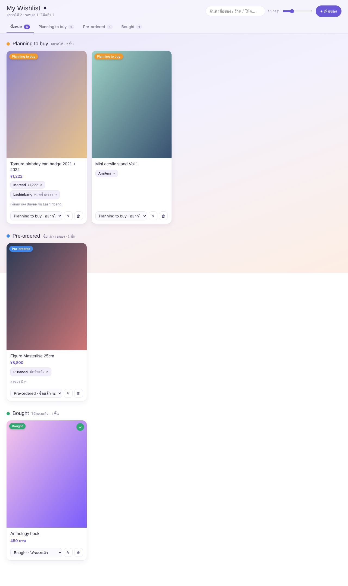

# My Wishlist ✦

หน้าเว็บรวม wishlist (Google Apps Script) — รูปใหญ่, แนบลิงก์ร้านได้หลายอัน, แบ่ง 3 สถานะ

- **Planning to buy** – อยากได้
- **Pre-ordered** – ซื้อแล้ว รอของ
- **Bought** – ได้ของแล้ว

ข้อมูลเก็บใน Google Sheet (แท็บ `Wishlist`) รูปที่อัปโหลดเก็บใน Google Drive โฟลเดอร์ `Wishlist Images`

## ติดตั้ง

1. สร้าง Google Sheet ใหม่ → **Extensions → Apps Script**
2. วางโค้ดจาก `Code.gs` ลงในไฟล์ `Code.gs`
3. กด **+ → HTML** ตั้งชื่อ `Index` แล้ววางโค้ดจาก `Index.html`
4. **Deploy → New deployment → Web app**
   - Execute as: **Me**
   - Who has access: **Only myself** (ถ้าตั้งเป็น Anyone ใครมีลิงก์ก็แก้/ลบได้)
5. อนุญาตสิทธิ์ แล้วเปิดลิงก์ Web app

แก้โค้ดภายหลัง: **Deploy → Manage deployments → Edit → Version: New version**

## การใช้งาน

- เพิ่มรูปได้ด้วยการลากวาง, **Ctrl+V**, เลือกไฟล์ หรือวางลิงก์รูป
- แต่ละลิงก์ใส่โน้ต (ราคา/ค่าส่ง) ได้ ชื่อร้านขึ้นอัตโนมัติจากโดเมน
- เปลี่ยนสถานะได้จาก dropdown ใต้การ์ด, คลิกรูปเพื่อดูเต็มจอ
